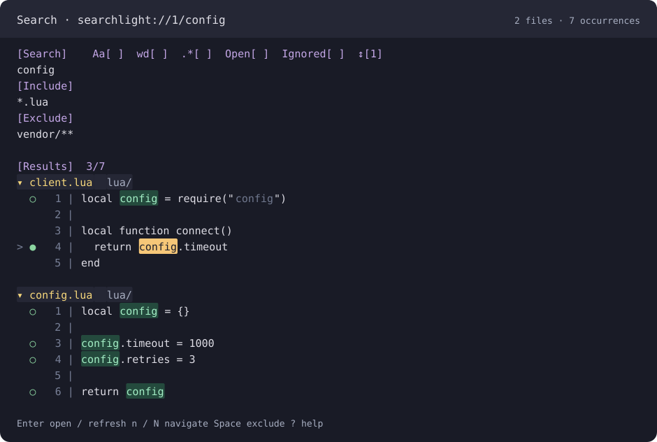
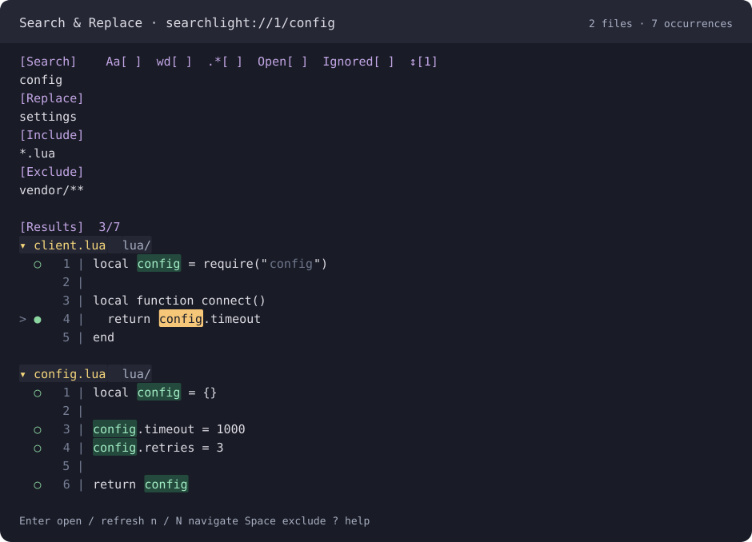

# Searchlight

**Keep your search open. Review every match. Replace on your terms.**

Searchlight provides persistent Search and Search & Replace panels for Neovim,
powered by ripgrep. Search a project or your open buffers, narrow the results, and
work through individual occurrences without losing your query. Choose Search for
querying and navigation, or Search & Replace to also edit matches. Replacement
edits stay in source buffers for you to review, undo, and save.



*Search: query, filter, exclude occurrences, and navigate sources.*



*Search & Replace: the same search workflow with replacement actions.*

*Panel illustrations generated from actual Neovim results. Open-file and ignored-file
icons are shown as labels for readability; colors depend on your colorscheme.*

[Install](#installation) · [Quick start](#quick-start) · [Features](#features) ·
[Keymaps](#keymaps) · [Configuration](#configuration) · [Benchmarks](#benchmarks)

## Features

| Feature | What you get |
| --- | --- |
| Two session types | Search has query, filters, and navigation; Search & Replace adds replacement input, capture previews, and edit actions. |
| Persistent sessions | Independent panels with their own mode, root, query, filters, options, selection, exclusions, and limits. Hide and reopen them during the same Neovim session. |
| Familiar editing | Edit fields with normal Vim motions, insert mode, and undo. Enter submits; Tab cycles fields. Typing never starts a search. |
| Flexible matching | Literal or ripgrep regex search, case sensitivity, whole words, and configurable surrounding context. |
| Project or buffer scope | Search disk files with modified and newly named unsaved buffers overlaid, or search only listed normal buffers. |
| Precise filters | Include/exclude globs, comma-separated or multiline, with ripgrep ignore rules and an option to include ignored files. Hidden files are included by default. |
| Readable results | Collapsible file groups, line numbers, merged context, occurrence counts, and every match highlighted—even several on one line. |
| Exact navigation | Move between individual occurrences with `n`/`N` or `[`/`]`; open the exact match in a source split with folds opened and the line centered. |
| Native source search | Opening a result sets Neovim's search register and `hlsearch`, so native `n`/`N` continue through that file. |
| Selective replacement (Search & Replace) | Exclude individual occurrences, replace one match or all enabled matches, and expand numbered or named regex captures. |
| Reviewable edits (Search & Replace) | Replacements remain unsaved, use a native undo block per source buffer, validate searched snapshots, and report skipped or failed edits. |
| Syntax highlighting | Use installed Tree-sitter parsers and your colorscheme for result code. Optional embedded-language highlighting; readable plain-text fallback. |
| Bounded asynchronous work | Cancellable searches, batched disk prefiltering, configurable resource limits, and a shared bounded syntax cache. Incomplete results block Replace all. |
| Neovim integration | Listed panel buffers, commands, buffer-local actions, existing mapping preservation, and normal split resizing and scroll margins. No required Lua plugin dependencies. |

## Installation

### Requirements

| Dependency | Required? | Details |
| --- | --- | --- |
| [Neovim](https://neovim.io/doc/install/) 0.12+ | Yes | Locally tested with 0.12.6. `setup()` checks the required Neovim APIs. |
| [ripgrep (`rg`)](https://github.com/BurntSushi/ripgrep#installation) on `$PATH` | Yes | Tested with 15.2.0. Replacement requires JSON capture-expansion support, which Searchlight probes automatically. Older builds can search but have replacement disabled if that capability is missing. |
| Tree-sitter parsers and highlight queries | Optional | Used for result syntax colors when installed. Searchlight does not install parsers or start LSP clients. |
| Nerd Font | Optional | Renders the two search-control icons. Their mappings and the `?` help remain usable without it. |

Check your executables with `nvim --version` and `rg --version`. There is no plugin
build step and no required Telescope, Plenary, or Tree-sitter plugin dependency.

### lazy.nvim

Add this specification to your [lazy.nvim](https://lazy.folke.io/spec) plugin list:

```lua
{
  'dmytr0x/searchlight',
  lazy = false,
  main = 'searchlight',
  opts = {},
}
```

This runs `require('searchlight').setup()` at startup and registers the commands and
default global mappings. For command-only lazy loading, replace `lazy = false` with
`cmd = { 'SearchlightNew', 'SearchlightReplaceNew', 'SearchlightFocus', 'SearchlightReopen', 'SearchlightClose' }`; the default
global mappings are registered after the plugin loads.

### Other plugin managers or a local checkout

Install `dmytr0x/searchlight` with your plugin manager, then call this after it loads:

```lua
require('searchlight').setup()
```

To try a checkout directly:

```sh
git clone https://github.com/dmytr0x/searchlight.git ~/searchlight
```

```lua
vim.opt.runtimepath:prepend(vim.fn.expand('~/searchlight'))
require('searchlight').setup()
```

For a local lazy.nvim specification, replace `'dmytr0x/searchlight'` with
`dir = vim.fn.expand('~/searchlight')`. The repository root is the plugin runtime
directory.

## Quick start

### Search

1. Run `:SearchlightNew` in your project, or `:SearchlightNew /path/to/project`.
2. Enter your query on the line below **Search** and press Enter in normal or insert
   mode. The default search is case-insensitive and literal, with two context lines.
3. Use `n`/`N` to visit occurrences. Press Enter on a match to open its source; use
   `:SearchlightFocus` to return to the panel. Enter on a file header collapses it.
4. Narrow the search with **Include** (for example, `*.lua, *.md`) and **Exclude**
   (for example, `vendor/**`), then press Enter in a field to refresh.
5. Space excludes an occurrence from the panel's result state. Search sessions have
   no Replace field or replacement actions; source buffers remain normally editable.

### Search & Replace

1. Run `:SearchlightReplaceNew [root]` (default mapping `<leader>sr`).
2. Enter your query and filters, then enter a value below **Replace**. Press Enter
   in a field to search and expand replacement values.
3. Use Space on a match to exclude it, `<localleader>n` to replace the selected
   enabled occurrence, or `<localleader>A` to replace all enabled matches.
4. Review the changed source buffers. Use `u` or Ctrl-r there to undo or redo, then
   `:write` or `:wall` when ready to save.

Both session types coexist. `:SearchlightFocus [id]` or `<leader>sP` restores a
surviving session with its original mode; there is no mode switch.
Use `:SearchlightReopen` to return to the most recently used panel, including after
closing or deleting it, with the same mode, inputs, options, and settings.

`<localleader>` defaults to `\`, so Replace all is `\A` unless you configured a
different local leader. Set `vim.g.maplocalleader = ','` **before opening a panel**
if you prefer `,A`. Press `?` in the panel for help.

**Searches are explicit.** Editing fields or source files marks results stale;
press Enter in an input line or `<localleader>R` in normal mode to refresh.
Option-toggle mappings debounce searches. Lua `set()` does the same for changed
search inputs by default; its refresh policy can wait for Enter or submit immediately.
In Search & Replace, Enter in Replace refreshes values; replacement is a separate action.

### A regex replacement example

Open `:SearchlightReplaceNew`, enable Regex with `<localleader>x`, use Include
`*.lua`, and enter these fields:

```text
[Search]
config\.(\w+)
[Replace]
settings.$1
```

After refreshing, the replacements are:

```diff
-config.timeout = 1000
-config.retries = 3
+settings.timeout = 1000
+settings.retries = 3
```

`$1` and `${name}` expand captures; `$$` inserts a literal dollar sign.
An empty replacement deletes the matched bytes. Capture expansion is available in
each occurrence's replacement value and through the [Lua preview API](#lua-api);
the panel has no additional before/after preview row.

## Panel and session behavior

Each source line appears once, even when it contains several matches. Matches are
highlighted individually; the selected occurrence has a distinct highlight, and
excluded occurrences are dimmed. Move onto a highlight to open or exclude that
occurrence, or to replace it in Search & Replace. From the gutter, actions use the
selected occurrence on that line, or its first match.

```text
[Results]  3/7
▾ client.lua  lua/
  ○   1 | local config = require("config")
      2 |
      3 | local function connect()
> ●   4 |   return config.timeout
      5 | end

▾ config.lua  lua/
  ○   1 | local config = {}
      2 |
  ○   3 | config.timeout = 1000
  ○   4 | config.retries = 3
      5 |
  ○   6 | return config
```

The header counts **occurrences**, not lines. `○` marks a match line; `●` marks the
cursor's match line, including stale or excluded results. A `⋯` row separates distant
context blocks. Context rows do not count as matches or replacement targets.
File collapse state survives refreshes, and navigation expands the selected file.

Panels open at the top of the tab. An untouched empty startup window is reused;
existing editor windows and split layouts are preserved. Every source jump creates
a new horizontal split below the panels, opens the exact occurrence, unfolds it,
and centers it with `zz`. Source windows inherit the editor's pre-panel options and
normal filetype/autocommand behavior.

Set `close_on_open = true` to use a panel as a peeker: opening a match also deletes
the panel and disposes its session. Enter in fields still refreshes the search, and
Enter on file headers still collapses or expands them. The default is `false`.

Sessions survive hiding or ordinary window closure within the running Neovim
instance. Their listed buffer names include the query (`searchlight://ID/term`) for
buffer pickers and `:ls`. `:SearchlightFocus` restores a panel at the top; selecting
its buffer also restores it. `:bdelete`, `:bwipeout`, or `:SearchlightClose` dispose
the session. `:SearchlightReopen` can recreate the most recently used panel after
disposal, retaining its root, mode, query, replacement, filters, search options,
section visibility, and captured configuration, including `close_on_open`, syntax
settings, and resource limits. Changing directories or calling `setup()` does not
change these saved settings. A surviving panel is focused without rerunning its
search; a recreated panel runs a fresh search and never applies replacements
automatically. Results, selection, and occurrence exclusions survive while the
session exists; disposed panels rebuild results. Only the latest panel's settings
are retained, within the current Neovim process. Repeating `setup()` preserves
surviving sessions.

Resize and scroll normally. Long lines do not wrap; horizontal scrolling,
`scrolloff`, and `sidescrolloff` work, including window-local overrides.
Hiding filters preserves their active values; the panel shows a reminder when
hidden filters affect the search. Search & Replace also supports hiding Replace
while retaining its active value. Search has no replacement section to reveal.

## Commands

| Command | Default global mapping | Action |
| --- | --- | --- |
| `:SearchlightNew [root]` | `<leader>sp` | Create an independent Search session. |
| `:SearchlightReplaceNew [root]` | `<leader>sr` | Create an independent Search & Replace session. |
| `:SearchlightFocus [id]` | `<leader>sP` | Focus a requested session or the most recently used surviving one. |
| `:SearchlightReopen` | — | Reopen the most recently used panel with its original mode and settings, recreating it if disposed. |
| `:SearchlightClose` | — | Delete the current panel and dispose its session. |

The root defaults to the invoking window's current directory and remains captured
after `:cd`. Escape spaces in command arguments. Existing conflicting global
mappings are preserved. Configure entry mappings independently in `setup()`:

```lua
require('searchlight').setup({
  mappings = {
    search = '<leader>sf',
    replace = '<leader>sR',
    recent = '<leader>sP',
  },
})
```

To install your own callbacks, disable the corresponding plugin defaults:

```lua
require('searchlight').setup({ mappings = { search = false, replace = false } })
vim.keymap.set('n', '<leader>sf', function()
  require('searchlight').search()
end, { desc = 'Searchlight: search' })
vim.keymap.set('n', '<leader>sR', function()
  require('searchlight').replace()
end, { desc = 'Searchlight: search and replace' })
```

Pass session options in a mapping callback to make a dedicated peeker mapping:

```lua
vim.keymap.set('n', '<leader>sk', function()
  require('searchlight').search({ close_on_open = true })
end, { desc = 'Searchlight: peek at a match' })
```

`replace({ close_on_open = true })` works the same way. To specify a root as well,
use `search('/path/to/project', { close_on_open = true })`. A session override of
`false` keeps its panel open even when the global default is `true`.

**Migration:** `SearchlightNew` now creates Search. For the former combined workflow,
use `SearchlightReplaceNew` or `replace()`. Lua `new()` and `focus()` have been
removed; use `search()` / `replace()` and `recent(id)` respectively.

## Keymaps

Panel mappings are buffer-local. Unless noted, use normal mode; ordinary editing
keys such as `d`, `w`, `x`, `c`, `r`, `o`, and `O` remain available in fields.

| Key | Action |
| --- | --- |
| `<localleader>/` | Focus Search. |
| `<localleader>r` | Focus Replace (Search & Replace only). |
| `<localleader>I`, `<localleader>E` | Focus Include / Exclude. |
| Tab | Cycle Search, Include, Exclude (normal and insert mode); Search & Replace adds Replace after Search. |
| Enter | Refresh in a field or on the controls (normal and insert mode); open a result or collapse/expand a file header (normal mode). |
| `n`, `N` | Next / previous occurrence; counts such as `3n` work, wrapping follows `wrapscan`. |
| `[`, `]` | Previous / next occurrence; stop at either end. |
| Space | Enable/exclude the occurrence under the cursor, otherwise the selected occurrence. |
| `<localleader>n`, `<localleader>A` | Replace the selected enabled occurrence / all enabled occurrences (Search & Replace only). |
| `<localleader>R` | Refresh using the current query, options, filters, and replacement value when available. |
| `<localleader>c` | Toggle Match case (`Aa`). |
| `<localleader>w` | Toggle Whole words (`wd`). |
| `<localleader>x` | Toggle Regex (`.*`). |
| `<localleader>o` | Toggle Only open files (`󰥩`). |
| `<localleader>g` | Toggle Also ignored (``). |
| `<localleader>f` | Hide/show filters; values remain active. |
| `<localleader>v` | Hide/show Replace; value remains active (Search & Replace only). |
| `<localleader>d`, `<localleader>L` | Change the session root / match limit and schedule or run a refresh. |
| `<localleader>q`, `<localleader>D` | Hide / delete the session. |
| `?` | Show/hide help. |

You can also edit the Search header's brackets directly. `[x]` enables a modifier;
`[]` or spaces-only brackets disable it. Any non-space character enables it;
malformed brackets disable it. Edit `↕[2]` to change context lines above and below
matches; `0` hides context. Invalid or unfinished context values keep the last valid
size. Direct edits and undo preserve your text and wait for explicit refresh.

## Matching and scope

- **Defaults:** case-insensitive, literal, whole words off, project scope, ignored
  files off, hidden files on. Empty queries remain idle; one-character queries work.
- **Patterns:** panel regexes use ripgrep's default engine and syntax, without
  implicit PCRE2 or Vim-pattern translation. The query accepts one logical line;
  Search & Replace also requires a single-line replacement.
- **Filters:** use positive globs in both fields, without a leading `!`. Includes
  form a union; exclusions win. Separate globs with commas or newlines. Brace
  alternatives (`*.{lua,md}`), character classes (`file[,.]txt`), and escaped commas
  (`notes\,draft.md`) are preserved. Whitespace and blank declarations are ignored
  when interpreting filters; editable text is retained exactly.
- **Project scope:** disk search includes modified and newly named unsaved buffers
  without duplicate disk hits. A clean buffer that differs from disk is searched
  from disk; replacement is blocked until the buffer agrees with that snapshot.
- **Only open files:** search current contents of listed normal buffers within the
  root, loading listed unloaded buffers as needed. Special buffers (panels,
  terminals, help, and similar) are excluded.
- **Hidden and ignored files:** hidden paths such as `.config/nvim/` are searched by
  default, subject to filters and ignore rules. Also ignored bypasses normal ignores
  and ripgrep config with `--no-config --no-ignore --hidden`. `.git` metadata is
  always excluded.
- **File identity:** real paths must stay within the root. Symlink and hard-link
  identities are deduplicated; current buffers take precedence for shared sources.
  Symlink traversal follows ripgrep's configured `--follow` policy.
- **Unsaved file eligibility:** new filenames are evaluated with real ripgrep glob
  and ignore behavior in a disposable tree, including ancestor ignore files and
  Git excludes. Searchlight creates no placeholder files in your project.

With Also ignored off, `RIPGREP_CONFIG_PATH` is checked before discovery. Supported
configuration includes long `--glob=`, `--iglob=`, type-filter flags, absolute
`--ignore-file=`, hidden/ignore/follow controls, and max-column/preview/no-heading
settings. Searchlight controls the matching flags itself. Unsupported flags, short
forms, relative ignore-file paths, or incompatible engine/output settings produce
a visible error. See the [accepted flags](lua/searchlight/rg.lua).

Opening a result sets Vim's search register and enables `hlsearch`. In the source,
native `n`/`N` support counts, follow `wrapscan`, include excluded occurrences, and
can reach beyond the panel's result cap. `:nohlsearch` clears native highlights;
a new `/` or `?` search takes over without clearing the panel's highlights.
Source navigation uses Vim regex syntax and the buffer's `iskeyword`, so regex and
whole-word navigation can differ from ripgrep's panel matches.

## Replacement and limits

Replacement is available only in Search & Replace. Search sessions keep the same
limits and stale-result handling, with no replacement values or previews.

Searchlight validates the searched snapshot, full buffer contents, changedtick,
pathname, write options, and disk contents/identity before applying edits, including
after source-loading autocommands. Changed, deleted, renamed, or unsupported sources
are skipped with reasons. Reports show applied, excluded, stale, unsupported, and
failed counts, including partial failures. Editing displayed result rows never edits
source files.

Replace next edits one enabled occurrence and advances to its surviving successor,
skipping exclusions and avoiding immediate revisits to inserted text. Replace all
needs a settled, current, complete, uncapped search. A match, inventory, output,
source-size, or snapshot-memory limit is visible and blocks full-scope replacement;
settled displayed matches may still be used by Replace next. Raise the relevant
limit and refresh. `<localleader>L` changes the current session's match limit.

After replacement, the applying panel refreshes; other affected sessions become
stale until explicitly refreshed, including affected Search sessions. Source edits,
undo/redo, writes, listing changes, and renames also invalidate relevant sessions
without searching. Unchanged snapshots retain exclusions; a changed snapshot
resets its old exclusions.

**Edits stay unsaved.** Each operation creates one native undo block per source
buffer, separate from prior edits; undo is per file, without a cross-file atomic
undo. CRLF, UTF-8/UTF-16 BOM, Latin-1, and missing-final-newline handling are covered
by save-and-byte-comparison tests. Newly loaded sources without a final newline
receive `nofixendofline`; existing buffers retain their write options. Binary sources
are omitted, and unsafe encoding/newline mappings are visibly skipped.

## Configuration

All available settings and their defaults:

```lua
require('searchlight').setup({
  mappings = {
    search = '<leader>sp',
    replace = '<leader>sr',
    recent = '<leader>sP',
  },

  close_on_open = false, -- delete the panel after opening a match

  -- Search defaults for new sessions
  match_case_sensetivity = false, -- use this exact API spelling
  match_whole_words = false,
  use_regular_expressions = false,
  only_search_open_files = false,
  also_search_ignored_files = false,
  context_size = 2,

  -- Result syntax colors
  syntax_highlighting = true,
  syntax_injections = false,
  syntax_max_file_bytes = 128 * 1024,

  -- Scheduling and per-session limits
  debounce_ms = 150, -- Lua set() and toggle mappings; Enter is immediate
  max_results = 10000,
  concurrency = 4,
  max_files = 100000,
  max_output_bytes = 4 * 1024 * 1024,
  max_source_bytes = 8 * 1024 * 1024,
  max_snapshot_bytes = 64 * 1024 * 1024,
})
```

The case option is spelled **`match_case_sensetivity`** in the current API.
For case-sensitive regex searches by default, set it and
`use_regular_expressions` to `true`. Boolean settings require booleans;
`context_size` is a nonnegative integer. Other numbers are positive integers,
except `debounce_ms`, which can be zero. Unknown settings are rejected.
Existing sessions keep their captured mode and search configuration when `setup()`
runs again. Omitted settings retain their configured values, including entries in a
partial `mappings` table. Each mapping accepts a nonempty string or `false` to
disable it; commands and Lua APIs remain available. Unknown keys, invalid values,
and keys resolving to the same sequence for different actions are rejected before
any registration changes. Remapping removes only mappings still owned by
Searchlight; user overrides survive later setup calls.

### Syntax colors and highlight groups

Plain results appear first; visible code receives syntax colors after a short
debounce. Missing parsers/queries, errors, oversized files, or exhausted budgets
leave readable plain text. Search highlights and selected/excluded styling take
priority. Set `syntax_highlighting = false` to disable syntax for new sessions.

Files above `syntax_max_file_bytes` stay plain. Raising the default 128 KiB cap can
increase uninterrupted parse pauses; a shared hard cap of 512 KiB still applies.
The global cache bounds parsers, source text, spans, and visible-row work across
panels. Long source lines over 4 KiB are not enriched. Cooperative capture
extraction and bounded retries keep background work controlled; these bounds do
not guarantee a fixed process RSS.

Set `syntax_injections = true` to color visible embedded languages, such as Markdown
code fences. Injections are one level deep and share the syntax budgets.
Colorscheme, filetype, and runtimepath changes update colors without rerunning
searches. After replacing highlight queries explicitly, call
`require('searchlight.highlight').reload()` or
`:doautocmd User SearchlightHighlightReload`.

| Group | Default | Purpose |
| --- | --- | --- |
| `SearchlightMatch` | Follows `Search` | Result matches. |
| `SearchlightSelected` | Follows `IncSearch` | Selected occurrence. |
| `SearchlightFilename` | Yellow (`#ffff00`) | File header name and extension. |
| `SearchlightPath` | White (`#ffffff`) | File header's relative directory. |
| `SearchlightControl` | Links to `Title` | Search controls. |
| `SearchlightMarker` | Links to `DiagnosticOk` | Result circle markers. |

The last four groups use default definitions and respect your colorscheme/config
overrides. `SearchlightMatch` and `SearchlightSelected` always follow `Search` and
`IncSearch`.

## Lua API

Use a session object returned by `search()` or `replace()`, or its numeric ID.
Omit the session argument with `nil` to address the current panel. Programmatic
updates do not activate a session or move focus; use `recent()` to restore it.
Avoid modifying returned session internals.

Both creation functions accept `search(root, options)` / `replace(root, options)`
or `search(options)` / `replace(options)`. Root and options are optional. You can
put `root` in the options table instead of passing it positionally; specifying
both is an error. Omitting root uses the invoking window's current directory.

```lua
local searchlight = require('searchlight')

-- Prefill the panel and wait for Enter.
local session = searchlight.search({
  root = vim.fn.getcwd(),
  query = 'TODO',
  include = { '*.lua', '*.md' },
  exclude = { 'vendor/**' },
  case = true,
  word = true,
  regex = false,
  open = false,
  ignored = false,
  context = 0,
  max_results = 2000,
  close_on_open = true,
  sections = { filters = false, help = false },
  refresh = false,
})

-- Patch values and submit once, immediately, with the final inputs.
searchlight.set(session, {
  query = 'FIXME',
  case = false,
  sections = { filters = true },
}, { refresh = 'immediate' })

-- Replacement configuration prepares previews; it never applies edits.
local replacement = searchlight.replace('/path/to/project', {
  query = 'config',
  replacement = 'settings',
  include = { '*.lua' },
  sections = { replace = true, filters = true },
  refresh = 'immediate',
})
```

Creation options and `set()` changes share these session keys:

| Key | Valid values and behavior |
| --- | --- |
| `query`, `replacement` | Single-line strings without CR/LF; `''` clears the field. `replacement` requires Search & Replace. |
| `include`, `exclude` | Dense lists of single-line strings, each retaining comma-separated glob syntax; `{}` clears the filter. |
| `case`, `word`, `regex`, `open`, `ignored` | Strict booleans. Explicit `false` overrides a configured `true`. |
| `context` | Finite nonnegative integer; `0` hides context. |
| `root` | Path string, normalized as for the positional root. |
| `max_results` | Finite positive integer, affecting only this session's match limit. |
| `close_on_open` | Boolean, affecting only this session's opening behavior. |
| `sections` | Partial table of booleans for `filters`, `help`, and `replace`; `replace` requires Search & Replace, even when `false`. |

Omitted keys keep existing values on update or use defaults on creation. Section
settings merge by key. Filters default to visible, help to hidden, and Replace to
visible in Search & Replace. Hidden fields retain active values; setting them does
not reveal them. Focusing a field reveals its section. Tables are copied, so
mutating or reusing an options table does not change earlier sessions or defaults.
Lua `nil` means omission. Unknown keys and invalid mixed patches are rejected
before changing session state or reading pending native edits. After validation,
explicit API keys win and unmentioned native edits survive. Mode is immutable.

The established `setup()` names supply defaults for the shorter session keys:

| `setup()` setting | Session key |
| --- | --- |
| `match_case_sensetivity` | `case` |
| `match_whole_words` | `word` |
| `use_regular_expressions` | `regex` |
| `only_search_open_files` | `open` |
| `also_search_ignored_files` | `ignored` |
| `context_size` | `context` |
| `max_results`, `close_on_open` | Same names. |

Syntax and performance settings without an interactive control remain `setup()`
settings. Patterns keep ripgrep syntax and the single-line query/replacement
contract; Vim patterns are not converted implicitly.

Choose execution with creation's `options.refresh`, or the optional third argument
of `set(session, changes, { refresh = ... })`:

| `refresh` | Behavior |
| --- | --- |
| `false` | Apply and render without searching. Changed search inputs cancel obsolete work and mark results stale; an empty query clears results. |
| `'debounced'` | Schedule one search after `debounce_ms`. |
| `'immediate'` | Cancel pending debounce and submit once immediately. |

Creation defaults to `false`. Existing two-argument `set()` calls default to
`'debounced'` for changed search inputs. Visibility and `close_on_open` alone update
without invalidating results or scheduling work. An explicitly requested
`'debounced'` or `'immediate'` policy submits even unchanged inputs or presentation
patches. Empty queries stay idle. Native typing and undo continue to wait for Enter;
Enter and `refresh()` submit immediately. The execution table accepts only `refresh`.

| Function | Purpose |
| --- | --- |
| `setup(options)` | Configure defaults and register commands, mappings, and events. |
| `search(root, options)` | Create, activate, and return a Search session. Root and options are optional; also accepts `search(options)`. |
| `replace(root, options)` | Create, activate, and return a Search & Replace session. Root and options are optional; also accepts `replace(options)`. |
| `recent(id)` | Restore and return the requested session; no ID restores the most recently used surviving one. |
| `reopen()` | Restore and return the most recently used panel; recreate it with its saved settings and refresh if disposed. No previous panel reports an informational message. |
| `set(session, changes, execution)` | Update session values and choose a refresh policy. Execution is optional. |
| `refresh(session)` | Search immediately with the current inputs. |
| `navigate(session, delta)` | Move the selection by an occurrence offset. |
| `open(session)` | Open the selected source occurrence; dispose the session if `close_on_open` is enabled. |
| `action(session, name, arg)` | Invoke a panel action, such as `exclude`, `replace_next`, or `replace_all`. |
| `close(session)` | Dispose a session and delete its panel. |

### Custom workflow mappings

Use Lua callbacks for dedicated workflows. Read dynamic values before opening the
panel, since activation changes the current buffer:

```lua
-- Search the cursor word in Lua files, with literal whole-word matching.
vim.keymap.set('n', '<leader>sw', function()
  local query = vim.fn.expand('<cword>')
  require('searchlight').search({
    query = query,
    include = { '*.lua' },
    regex = false,
    word = true,
    case = true,
    refresh = 'immediate',
  })
end, { desc = 'Searchlight: cursor word in Lua files' })

-- Open an editable replacement preset without running it yet.
vim.keymap.set('n', '<leader>sC', function()
  require('searchlight').replace({
    query = 'config',
    replacement = 'settings',
    include = { '*.lua' },
    regex = false,
    sections = { replace = true, filters = true },
    refresh = false,
  })
end, { desc = 'Searchlight: prepare config replacement' })
```

For reusable presets, define a local Lua table and pass it to `search()` or
`replace()` from a callback. To patch an existing session, keep its returned object
or ID and pass it to `set()`. `setup().mappings` continues to configure entry
mappings; set an entry to `false` when replacing it with your own callback.

For capture-aware previews in a Search & Replace session after results settle:

```lua
local replace = require('searchlight.replace')
local occurrence = require('searchlight.results').selected(session)
local preview_line = replace.preview(occurrence)
```

`preview()` returns the source match line with that occurrence replaced, or `nil`
when the occurrence is from Search, missing, stale, or lacks replacement support.
Replacement actions and direct replacement focus/section operations return `nil`
and a reason in Search; they never promote the session to Search & Replace.

## Benchmarks

Measurements from **2026-10-15**, on **macOS 26.6.2 / arm64**, with **Neovim 0.12.6**
and **ripgrep 15.2.0**. These are local synthetic, headless runs; timings depend on
hardware, filesystem, parsers, and workload, and do not measure terminal rendering.
The measurements below use the separate session modes described for each workload.

### Search workloads

One `make benchmark` run, using the default 10,000-occurrence cap:

| Workload | Measured result |
| --- | --- |
| Search & Replace: 200 files, 20,000 occurrences | First results **37.16 ms**; capped search settled in **464.79 ms**, displaying 10,000 occurrences. |
| Same workload, event-loop responsiveness | 35 heartbeat callbacks; longest observed gap **24.10 ms** with a 10 ms timer. |
| Search: 2,000 files, no matches | Complete in **75.49 ms**, using **4 ripgrep processes**. |
| Single `rg --json` on the no-match fixture | **24.55 ms** for context; this command does not include Searchlight's inventory, snapshot, and panel work. |

The current benchmark uses Search & Replace for the capped Replace-all workload
and Search for the no-hit workload, labeling each output by mode. It checks that
the event loop keeps running, capped results reject Replace all, and no-hit
searches avoid launching a process per file.

### Syntax highlighting overhead

`make syntax-benchmark` alternates fresh enabled/disabled processes for three trials
each. The enabled workload includes **syntax injections**, which are off by default.
Current fixtures use Search for dense/sparse Lua and C, large and long-line files,
embedded languages, scrolling, and lifecycle cycles, plus explicit Search & Replace
sessions for replacement cycles.

| Metric | Syntax off | Syntax + injections on |
| --- | ---: | ---: |
| First results, median | 17.60 ms | 17.80 ms |
| Warm navigation, p95 | 0.076 ms | 0.079 ms |
| Cached drawing, p95 | 0.229 ms | 0.417 ms |
| Syntax-worker heartbeat gap, p95 | 0.054 ms | 1.828 ms |
| Longest syntax-worker heartbeat gap | 0.187 ms | 18.504 ms |
| Kernel peak process RSS, median | 134.16 MiB | 154.77 MiB |

All six gates passed: first-results overhead, warm-navigation overhead, baseline
navigation, cached-drawing overhead, heartbeat responsiveness, and RSS overhead.
RSS includes the whole Neovim process, parsers, and benchmark workload.
See the [search benchmark](tests/nvim/benchmark.lua) and
[syntax benchmark gates](tests/nvim/syntax_benchmark.py) for methodology and thresholds.

Reproduce from a checkout:

```sh
make benchmark
make syntax-benchmark # also needs Python 3 and /usr/bin/time (GNU time on Linux)
```

The syntax runner prints summary measurements and writes a full JSON report to
`/tmp/searchlight-syntax-benchmark.json` by default. Set `SEARCHLIGHT_BENCH_TRIALS`
or `SEARCHLIGHT_BENCH_REPORT` to change the trial count or output path.

## Troubleshooting

| Symptom | What to check |
| --- | --- |
| `:SearchlightNew` is unavailable | Ensure the plugin has loaded and `setup()` has run. With command lazy loading, use a command to load it first. |
| ripgrep is not installed | Check `:echo executable('rg')`; it must return `1` in Neovim's environment. |
| Replacement is unavailable | Use `:SearchlightReplaceNew` for replacement. In that mode, check the panel message and `rg --version`. Install a build with JSON replacement/capture support; 15.2.0 is tested. |
| Results did not change after editing | Refresh with Enter in a field or `<localleader>R`; typing does not launch a search. |
| Replace all is blocked | Wait for the search to settle, refresh stale results, or increase the reported limit and refresh. |
| A hidden file is missing | Check Include/Exclude and ignore rules. Hidden files are already enabled; Also ignored includes ignored paths. `.git` stays excluded. |
| ripgrep config is rejected | Use the supported long flags described above, or enable Also ignored to bypass config and ignore rules. |
| Missing result syntax colors | Check installed parsers/queries and file-size limits. Plain-text results remain usable. |
| Control icons appear as boxes | Use a Nerd Font or the toggle mappings; `?` explains every control. |

## Development

```sh
make test
make benchmark
make syntax-benchmark
make format-check # requires StyLua; CI uses 2.5.2
```

Tests isolate Neovim/XDG/log state and use real filesystem fixtures, real ripgrep,
and an injected process driver for deterministic asynchronous failures. They require
ripgrep's expanded JSON replacements. Files ending in `_spec.lua` are discovered
automatically. On **2026-10-15**, the local suite passed **305/305 tests** in
31.68 seconds. `make format-check`, `make benchmark`, and all six
`make syntax-benchmark` gates passed. An interactive Neovim walkthrough verified
both commands, root arguments with spaces, global mappings, normal/insert field
cycling, help, Search replacement guards, navigation, hide/restore, coexistence,
selective/bulk replacement, unsaved edits, and source undo.

[CI](.github/workflows/test.yml) runs tests and search benchmarks on Neovim stable
and nightly on Linux and macOS, checks formatting, and runs the syntax benchmark
on Linux.

```text
lua/searchlight/  Plugin modules and public init.lua facade
tests/nvim/      Isolated test configuration, fixtures, assertions, and benchmarks
docs/images/     Search and Search & Replace panel illustrations
```

The public facade coordinates sessions, entry mappings, and actions; the small
mode definition owns available fields and replacement capability. Scope/source
modules own eligibility, snapshots, and edit validation. Results and view own
occurrence selection and panel layout; highlight owns the shared syntax cache.
`process.start(argv, opts, done)` is the replaceable process boundary for tests.

For bugs or feature requests, [open an issue](https://github.com/dmytr0x/searchlight/issues)
with your Neovim/ripgrep versions, relevant configuration, and a minimal reproduction.
